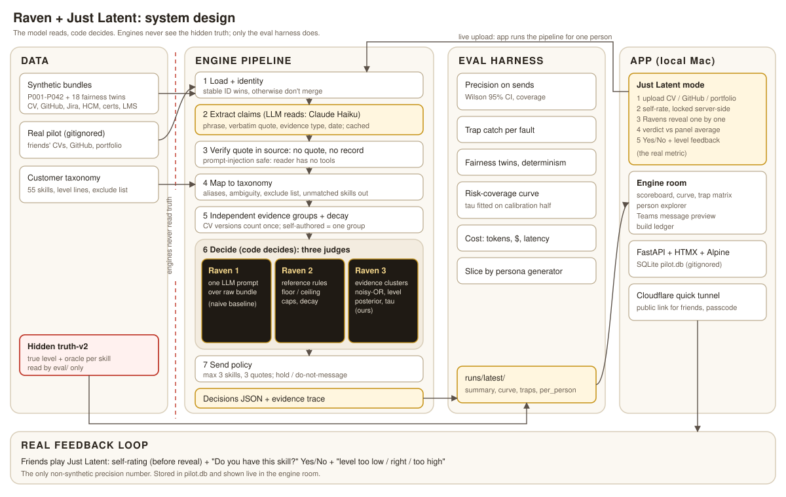

# latent-raven

Raven infers an employee's skills and proficiency levels from work evidence (CV, GitHub, Jira, certs, LMS, assessments, docs) and decides, per skill, whether to send it to the person for confirmation or hold. **Latent** is the game mode: you rate yourself first, three Ravens judge, and you see if you match.



- **The model reads, code decides.** An LLM extracts claims with verbatim quotes, and every quote is checked against the source. A claim without a quote is dropped.
- **Three judges, one harness.** All three are run and scored by the same harness on the same data:
  - Raven 1: one-prompt LLM baseline.
  - Raven 2: rule-based reference engine (floor/ceiling, caps, decay).
  - Raven 3: evidence clusters, dependence-aware combination, calibrated threshold.
- **Honest eval.** Only `eval/` can read the hidden truth. Precision on sends comes with Wilson CIs, alongside coverage, traps caught, fairness-twin flips, cost, and a check of whether the engine is just agreeing with the model that wrote the data.

## Results (synthetic test half, 21 personas)

| Judge | Precision (95% CI) | Coverage | Traps caught | Twin flips |
|---|---|---|---|---|
| Raven 1 | 56% (49-63) | 98% | 37/68 | 37 |
| Raven 2 | 76% (53-90) | 14% | 39/68 | 4 |
| Raven 3 | 94% (83-98) | 47% | 47/68 | 5 |

95% precision is not proven: the lower bound is 83%. Raven 3 holds any skill whose evidence never shows a level (a middle-level guess passes the ±1 rule 75% of the time; that is gaming the metric, not reading evidence). Before that rule it scored 93% (84-97) at 58% coverage, and 37 of its 139 sends were guesses. The threshold is refitted on the calibration half after every rule change. On the hardest slices (Claude-written and adversarial personas) Raven 3 is at 88% and 86%. Details: `data/notes/00-dataset-status.md`.

## Tech stack

| Layer | Choice | Why |
|---|---|---|
| Language | Python 3.13, uv | eval statistics + JSON pipeline; one toolchain |
| Types / contracts | pydantic v2 | `types.py` and `panel.py` are the seams between stages, engines and app |
| LLM | Claude Haiku via headless `claude -p` | cheap structured extraction, per-call cost in the log, disk-cached |
| Decision engines | plain Python | deterministic, testable, no model in the decide step |
| Storage | JSON files (dataset, cache, runs) + SQLite `pilot.db` (stdlib) | no database server for a pilot this size |
| Web | FastAPI + Jinja2 partials, HTMX 2, Alpine 3, hand-written CSS | server-rendered, no frontend build |
| PDF intake | poppler `pdftotext` | robust text from CV PDFs |
| Sharing | Cloudflare quick tunnel (`cloudflared`) | public link to a laptop, no deploy |
| Diagrams | tldraw (source), SVG (README) | |

## Run

```bash
uv sync
uv run python scripts/run_extraction.py      # stages 1-5, cached (needs the `claude` CLI)
uv run python -m imocha_raven.eval.run        # scoreboard -> runs/latest/
scripts/serve.sh                              # app on http://127.0.0.1:8000
scripts/tunnel.sh                             # optional public link via Cloudflare quick tunnel
```

[AGENTS.md](AGENTS.md) covers the repo map, the full run guide, environment variables and the rules that keep the eval honest.

All people in `data/` are fictitious. Real pilot data is never committed.
