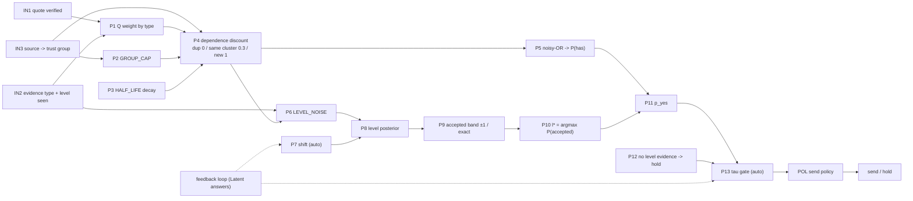

# Raven 3 interiors

How Raven 3 turns verified evidence into one decision per skill, every parameter it uses, who owns each one, and where each idea came from. The parameter table is generated from `src/imocha_raven/engines/raven3_params.py`. Its IDs (P1..P13) match the comments in `raven3.score_skill` / `decide`, so docs, code and the app's replay share one vocabulary.

## Index

| ID | Section |
|---|---|
| R3.1 | [Why not just the plan's logic](#r31-why-not-the-plans-logic) |
| R3.2 | [Input, output, interpretation](#r32-input-output) |
| R3.3 | [Parameter DAG](#r33-dag) |
| R3.4 | [Parameter table with sources](#r34-parameters) |
| R3.5 | [Worked example: P008 Kubernetes](#r35-worked-example) |
| R3.6 | [Auto-tuned vs human-owned](#r36-owners) |
| R3.7 | [From the research, not built yet](#r37-not-yet) |
| R3.8 | [See it in the app](#r38-app) |

## R3.1 Why not just the plan's logic

iMocha's plan gives a rulebook. Raven 2 implements it: strongest group sets a base and extra groups raise it, then floor/ceiling for the level, then fixed decay windows. The research agents flagged three weaknesses:

- "Independent groups count once" is stated but not enforced (02, point 8).
- Floor/ceiling is not a probability, and the ±1 rule quietly turns a 2-wide uncertainty into a Yes (02, point 5).
- The pass rule needs a lower confidence bound, not a point estimate (05, point 1; 02).

Raven 3 keeps the plan's contract: the Yes definition, no quote no record, applied over listed, and the send policy. It replaces the scoring with the calibrated evidence-fusion design from 06, trimmed for the demo per sprint 01 §D.7. Two rules are our own: the applied-work level correction (`shift`) and "no level evidence, no level".

## R3.2 Input, output, interpretation

**Input.** Clean claims for one person, produced by the shared pipeline (stages 1-5). Each claim has a verified quote, an evidence type, an optional level seen, a date, a source, a trust group and a cluster.

**Output per skill** (`Decision` plus `trace`):

| Field | Meaning | How to read it |
|---|---|---|
| `p_has` | Probability the person has the skill | Above 0.9 means several independent records agree |
| `level_dist` | Probability of each level | One tall bar means confident; a flat shape means the level is unknown |
| `best` (l*) | Level whose ±1 band holds the most probability | The level we would put in the message |
| `p_yes` | p_has × P(accepted at l*) | The engine's own estimate of a Yes |
| `tau` | Send threshold | Send if p_yes ≥ tau |
| `level_evidence` | Did any record show a level? | False means hold, whatever p_yes says |
| `action` | send / hold / not_extract / do_not_message | Final, after the send policy |

Interpretation:
- **send:** confident in the skill and its level within ±1. Not "expert", just "we can name the level".
- **hold:** either below tau (thin, old or self-stated evidence) or no level shown. In the app these appear as "bring proof".

## R3.3 Parameter DAG

Read it left to right: weights become per-record evidence (P1-P4), evidence becomes possession (P5) and a level distribution (P6-P10), and both meet in p_yes (P11), which is gated by the no-level rule and tau (P12-P13). Only P7 and P13 are touched by the feedback loop.

## R3.4 Parameter table with sources

Sources: 06 = `docs/research/06-codex-alt-engine.md`, 02 = `docs/research/02-methods.md`, 05 = `docs/research/05-codex-adversarial-review.md`, D7 = `docs/sprint/01-eval-contract-vs-engine.md` §D.7, plan = iMocha's evaluation plan by step ID (kept local), spec = `data/spec/PERSONA_SPEC.md` §8.

| ID | Parameter | Value | Owner | What it does | Source | Feeds |
|---|---|---|---|---|---|---|
| IN1 | quote_verified | substring match after normalising | contract | Drops any claim whose quote is not found in the source text: no quote, no record. | plan STEP-1 and L2 interface (sprint 01 L2); kept by 06 section 1 | P1 |
| IN2 | evidence_type + level_seen | applied/test/listed/course/cert/...; level from level lines | contract | What kind of record it is and which customer level line it shows; a test alone shows at most level 1. | plan STEP-3 'did > listed', STEP-4.1-4.2; spec D-U2 (applied work first) | P1, P6 |
| IN3 | group (source -> trust group) | {'assessments': 'measured', 'github': 'work', 'github_public': 'work', 'jira': 'work', 'servicenow': 'work', 'salesforce': 'work', 'authored_doc': 'authored', 'hcm': 'org', 'certs': 'third_party', 'lms': 'training', 'cv': 'self'} | human | Maps each source system to a trust group (measured, work, authored, org, third_party, self, training). | plan S3 source table and STEP-4.7 conflict order | P2, P4 |
| P1 | Q (evidence weight by type) | {'test': 0.85, 'applied': 0.8, 'authored_doc': 0.7, 'cert': 0.6, 'other': 0.2, 'course': 0.15, 'listed': 0.12, 'self_rating': 0.1} | human | How much one record of this type raises the chance the person has the skill. | 06 section 2 q_i = P(H=1|e_i) (should be isotonic-calibrated; v0 hand-set); ordering from plan STEP-3.1-3.4 | P4 |
| P2 | GROUP_CAP | {'self': 0.3, 'training': 0.15} | human | Ceiling on self-stated and training evidence, however many times it is repeated. | plan S3 source caps, adapted from a level cap to a probability cap | P4 |
| P3 | HALF_LIFE_Y (decay) | 2.5 years | human | Evidence loses half its weight every 2.5 years, continuously, instead of falling off a cliff. | 06 section 3 continuous recency curve; D7 'one exponential half-life'; value sits between plan STEP-3.5 windows (2y tools, 5y domain) | P4 |
| P4 | dependence discount (SAME_CLUSTER) | duplicate 0, same cluster 0.3, new cluster 1 | human | The strongest record in a cluster counts fully, repeats of the same work count 0.3, duplicates count 0. | 06 section 2 max-in-cluster and d_c; D7 fixed values; 02 point 8 ('independent groups count once' is stated, not enforced); plan S3.1, STEP-3.3 | P5, P6 |
| P5 | noisy-OR -> P(has) | 1 - prod(1 - weight) | formula | Combines the weighted records into one probability that the person has the skill. | 06 section 2 dependence-adjusted noisy-OR; 02 methods table (replaces plan STEP-3's ad-hoc strongest-plus-extras) | P11 |
| P6 | LEVEL_NOISE | [0.6, 0.25, 0.1, 0.05] | human | How likely the true level is 0, 1, 2 or 3 steps away from the level a record shows. | 06 section 2 r_{i,l} = P(L=l|e_i) (should be learned from assessments; v0 hand-set); 05 fix 'calibrated distribution over levels' | P8 |
| P7 | shift | baseline from eval; live overlay from feedback loop | auto | Adds +1 to levels read from applied work, correcting the reader's habit of under-levelling it. | ours: extractor audit (applied work read one level low); fitted on the calibration half; auto-tuned by feedback.py | P8 |
| P8 | level posterior | flat prior x prod(LEVEL_NOISE^weight) | formula | Turns all level readings into a probability for each level. | 06 section 2 weighted product-of-experts fusion | P9 |
| P9 | accepted band | +-1 on K4 scales, exact on K3 | contract | The levels at which the person would still answer Yes. | plan S1 Yes definition (has skill and level within +-1; exact on 3-level scales) | P10 |
| P10 | l* = argmax P(accepted) | level whose band holds the most probability | formula | Picks the level most likely to be answered Yes, not simply the most likely level. | 06 section 2; D7 keep-list | P11 |
| P11 | p_yes | P(has) x P(accepted at l*) | formula | The engine's probability that this message would get a Yes. | 06 section 2 final probability; 05 fix 'send only when P(|pred - true| <= 1) clears a threshold' | P13 |
| P12 | no level evidence -> hold | rule | contract | If no record shows a level, hold: a middle-level guess passes +-1 75% of the time and is not a reading. | ours: found through the trace visual (37 of 139 sends were guesses); grounded in plan STEP-4.1 and spec D-U2 | P13 |
| P13 | tau (send threshold) | baseline from eval; live overlay from feedback loop | auto | Send only when p_yes clears this line; trades coverage for precision. | 02 selective classification and conformal risk control (Geifman and El-Yaniv; Angelopoulos et al.); 06 section 2; 05 point 1 (gate on a lower bound); fitted on the calibration half; auto-tuned by feedback.py | OUT |
| POL | send policy | max 3 skills, 3 quotes; consent; generic exclude list | contract | Last gate for every engine: consent, generic skills, message size. | plan STEP-5.3, 5.7, 5.8 (sprint 01 L2.7, L2.9) | OUT |

## R3.5 Worked example: P008 Kubernetes (SRE, CKA certified)

Raven 3 output (`Raven3.explain`, baseline tau 0.364, shift 1):

| # | Type | Group | Q x cap x decay = q | Discount | Weight | P(has) so far | Level seen -> used |
|---|---|---|---|---|---|---|---|
| 1 | applied | work | 0.8 x 1.0 x 0.8796 = 0.7037 | 1.0 (new cluster) | 0.7037 | 0.7037 | 2 -> 3 |
| 2 | applied | work | 0.8 x 1.0 x 0.8796 = 0.7037 | 1.0 (new cluster) | 0.7037 | 0.9122 | 2 -> 3 |
| 3 | authored_doc | authored | 0.7 x 1.0 x 1.0 = 0.7 | 1.0 (new cluster) | 0.7 | 0.9737 | None -> None |
| 4 | authored_doc | authored | 0.7 x 1.0 x 0.8796 = 0.6157 | 0.3 (same cluster) | 0.1847 | 0.9785 | None -> None |
| 5 | applied | work | 0.8 x 1.0 x 0.5811 = 0.4649 | 0.3 (same cluster) | 0.1395 | 0.9815 | 2 -> 3 |
| 6 | cert | third_party | 0.6 x 1.0 x 0.6366 = 0.3819 | 1.0 (new cluster) | 0.3819 | 0.9886 | None -> None |
| 7 | applied | self | 0.8 x 0.3 x 0.9389 = 0.2817 | 1.0 (new cluster) | 0.2817 | 0.9918 | 2 -> 3 |
| 8 | applied | self | 0.8 x 0.3 x 0.8796 = 0.2639 | 0.3 (same cluster) | 0.0792 | 0.9924 | 2 -> 3 |
| ... | 5 more records | | | | | | |

- **P(has)** after all 13 records: **0.9954**.
- **Level distribution** L1..L4: [0.015, 0.1119, 0.7611, 0.1119].
- **P(accepted) per candidate level:** {1: 0.127, 2: 0.8881, 3: 0.985, 4: 0.873}. The best is **L3**, whose band [2, 3, 4] holds 0.985.
- **p_yes** = 0.9954 × 0.985 = **0.9804**, which is ≥ tau 0.364, so the action is **send at level 3**.

Notice the discount column: repeated records from the same repository count 0.3, and duplicates count 0. That is P4 doing the work the plan only states.

## R3.6 Auto-tuned vs human-owned

- **auto** (P7 shift, P13 tau): moved by `feedback.py` from Latent answers, inside guardrails (minimum labels, step limits, misses-only shift). This is borrowed from RLHF, not RLHF: answers are the reward signal, but no reward model is trained and no weights are learned. See `docs/playbook/productionizing-raven.md` PB.11.
- **human** (IN3, P1-P4, P6): changed only with audit labels and a shadow run.
- **contract** (IN1, IN2, P9, P12, POL): fixed by the evaluation contract or the user's decisions.
- **formula** (P5, P8, P10, P11): mathematics, no knob.

## R3.7 From the research, not built yet

| Idea | Source | Status |
|---|---|---|
| Calibrated q_i (isotonic or temperature scaling) | 06 section 2 | P1 is hand-set; needs labelled answers or audits |
| Contradiction likelihood ratios (failed test, expired cert, explicit No) | 06 section 3; plan STEP-3.6 | not implemented; Raven 2 handles test conflict |
| Learned decay per skill family | 06 section 3 | one half-life for all skills |
| Semantic and time-overlap clustering | 06 section 3 | clusters by source lineage and project key only |
| Level probabilities calibrated on assessments | 05; 06 section 3 | LEVEL_NOISE is hand-set |
| Person-level cluster bootstrap for the precision bound | 02 point on clustering; 05 point 1 | Wilson interval per send |

## R3.8 See it in the app

The engine room (`/scoreboard`) has a "Raven 3 interiors" view:
- The parameter DAG, with every node clickable to show its one-liner, value, owner and source.
- A slow, step-by-step replay of one person's skill: records join one at a time, P(has) climbs, the level bars form, the band is picked, and p_yes meets tau.
- A replay of the feedback loop, round by round: the precision lower-bound curve against tau, the target line, the clamped step, and the said-vs-ability split for shift.

Regenerate the replay data with `uv run python -m imocha_raven.eval.simulate_feedback --write`.
