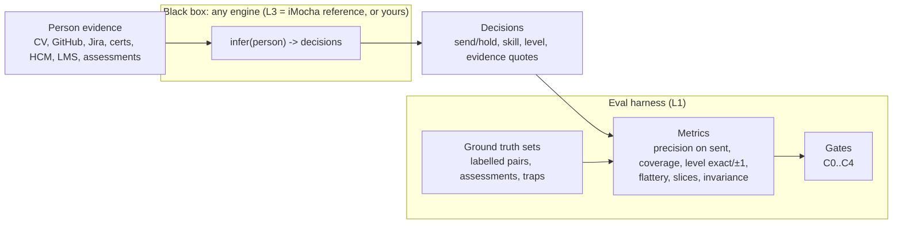

# WorkRaven - Eval contract vs reference engine

The two docs are mostly iMocha's internal eval for their own WorkRaven black box. Read them as three layers. Layer 1 is the **exam** (how any engine is scored). Layer 2 is the **interface** (what any engine must take in and put out). Layer 3 is **iMocha's own engine config** (one answer to the exam, not the answer). You must build to layers 1 and 2. Layer 3 is the baseline you run on the same harness and try to beat.

## Index

| ID | Section |
|---|---|
| L | [The three layers](#l-the-three-layers) |
| L1 | [Layer 1 - Eval contract (the exam)](#l1-eval-contract) |
| L2 | [Layer 2 - Interface contract (what goes in and out)](#l2-interface-contract) |
| L3 | [Layer 3 - Reference engine (iMocha's params)](#l3-reference-engine) |
| GR | [Grey zone - items that are both](#gr-grey-zone) |
| CH | [What this changes in 00-sprint](#ch-what-this-changes) |
| D | [New demo story](#d-new-demo-story) |

---

<a id="l-the-three-layers"></a>
## L · The three layers



- **L1 eval contract** = fixed. Every engine is measured the same way.
- **L2 interface** = fixed. Lets engines be swapped.
- **L3 reference engine** = free. iMocha's choices, your baseline.

---

<a id="l1-eval-contract"></a>
## L1 · Eval contract (the exam)

| ID | Item | What it fixes | Plan ref |
|---|---|---|---|
| L1.1 | Definition of Yes / No | Has skill AND level within ±1 (exact on scales with 3 or fewer levels) | S0.1, STEP-2.C |
| L1.2 | Yes rate | Yes ÷ answers, on skills the engine chose to send. Coverage is not the target | S0.1 |
| L1.3 | Not counted | No reply; people who say Yes to all of 10+ asks | S0.1, STEP-6.B |
| L1.4 | Targets | ≥95% live, ≥97% offline | S0.1 |
| L1.5 | Error budget | 7 failure causes, each with a share of the 5% and a test | S1.1 |
| L1.6 | Live pass rule | ≥96% on 400+ answers from 100+ people (weak, see 00-sprint R.1.1) | S1.2 |
| L1.7 | Guard metrics | Flattery delta vs assessments, exact level, level spread, no easy skills, slices ≥93%, answer rate, invariance, coverage reported | S1.3 |
| L1.8 | Ground-truth sets | Labelled pairs (200), assessment set (100×3), reader set, mapping set, identity set | GT.A |
| L1.9 | Checks | What gets graded, by whom, how often | GT.B |
| L1.10 | Checkpoints | C0 readers, C1 offline, C2 internal staff, C3 design partner, C4 GA | GT.C, P7 |
| L1.11 | Answer scoring | How each Teams answer counts (Yes / No / not counted / excluded) | STEP-6.B, P5 |
| L1.12 | Live monitors | Weekly scorecard, stop rule (slice <93% for 2 weeks), delta report per version | STEP-7.5-7.7 |
| L1.13 | Fairness | Name/gender/university swap must not move skill or level | S1.3.7, P6.A.3 |

These do not depend on how the engine works. Build them once, run any engine through them.

---

<a id="l2-interface-contract"></a>
## L2 · Interface contract

Product and policy constraints any engine must respect. Not internals.

| ID | Constraint | Plan ref |
|---|---|---|
| L2.1 | Input: per-person evidence from allowed sources only. Never email, chat, meetings, calendars, browsing, time tracking | S3.4 |
| L2.2 | Authored work only if the customer opts in, and only content the person wrote | S3.3 |
| L2.3 | Output skill = one entry in the customer's taxonomy | STEP-2 |
| L2.4 | Output level = the customer's scale, with that skill's level line | STEP-2.B, STEP-6.A |
| L2.5 | Output carries up to 3 evidence items that a person can check | STEP-6.A |
| L2.6 | The engine may abstain (hold). Abstention is not an error | S0, P0.4 |
| L2.7 | At most 3 skills per person per message; no generic skills (exclude list) | STEP-5.3, 5.7 |
| L2.8 | Identity: evidence joined to the right person | STEP-1.5 |
| L2.9 | Consent: notice + opt-out, EU opt-in | STEP-5.8 |

Proposed code interface (sketch):

```python
class PersonBundle(BaseModel):          # input
    person_id: str
    sources: list[SourceDoc]            # raw text or structured rows, with source_type, source_id, dates

class Decision(BaseModel):              # output, one per candidate skill
    person_id: str
    skill_id: str                       # customer taxonomy id
    action: Literal["send", "hold"]
    level: int | None                   # on customer scale; None if held for level
    p_yes: float | None                 # optional; engines that don't score leave None
    evidence: list[Citation]            # <=3, each points to source_id + exact quote
    reason: str                         # which rule / threshold decided

class Engine(Protocol):
    name: str
    def infer(self, bundle: PersonBundle, taxonomy: Taxonomy) -> list[Decision]: ...
```

---

<a id="l3-reference-engine"></a>
## L3 · Reference engine (iMocha's params, replaceable)

These are iMocha's design and tuning choices inside their black box. Run them as `ReferenceEngine` on your harness; you are free to replace any of them.

| ID | Param / design choice | iMocha's value | Plan ref |
|---|---|---|---|
| L3.1 | Reader principle | "Model reads, code decides"; LLM extracts typed facts only, closed lists | STEP-1, 1.2 |
| L3.2 | Evidence record schema | 13 fields (person_id ... reader_version) | STEP-1 1.A |
| L3.3 | Which reader per source | Model for CV/authored work; rules for HCM/LMS/assessments; mixed for Jira/GitHub | STEP-1 1.B |
| L3.4 | Skill mapping method | Alias → closed-list LLM pick → review queue; cached per customer | STEP-2.1-2.4 |
| L3.5 | Source groups + caps | 10 source rows, group, establishes-skill flag, max level shown | S3 table |
| L3.6 | Group independence | Same group counts once; repeats capped | S3.1, STEP-3.3 |
| L3.7 | Has-skill scoring | Base from strongest group, extra groups raise most, did > listed | STEP-3.1-3.4 |
| L3.8 | Routes to High | Measured ≤2y; work records 3+ months in 24; work/authored + 1 group; verified cert + 1 group | STEP-3.A |
| L3.9 | Never High alone | CV, learning, job history, self-rating, unchecked cert | STEP-3 |
| L3.10 | Decay windows | Tools/languages ~2y, domain ~5y | STEP-3.5 |
| L3.11 | Contradiction | Failed test, expired cert, "No" lower the score | STEP-3.6 |
| L3.12 | Bands | High / Medium / Low / Disputed; only High sent | STEP-3.B |
| L3.13 | Hidden score | 0-100 sort key, priors, versioned per customer | STEP-3 |
| L3.14 | Level method | Floor / ceiling; spread 0-1 → floor, 2 → floor+1, 3+ → hold | STEP-4.3-4.5, 4.A |
| L3.15 | Level-kind signals | 4 kinds (knows / with help / alone / leads) from evidence signals | STEP-4.B |
| L3.16 | Never used for level | CV length, mentions, tenure, title, employer | STEP-4.6 |
| L3.17 | Conflict order | measured > work > authored > org > third party > self > training | STEP-4.7 |
| L3.18 | Selection order | Job-role skills first, max 3 | STEP-5.6-5.7 |
| L3.19 | Learning | Logistic regression on answers at 1,000/customer; level calibrated on assessments | STEP-7.1-7.2 |

---

<a id="gr-grey-zone"></a>
## GR · Grey zone

| ID | Item | Why grey | How to treat |
|---|---|---|---|
| GR.1 | "No quote, no record" | Engine design (L3), but the eval also needs it: error budget row "invented skill" = 0, blocks | Contract version: every **sent** evidence item must string-match its source. Engine is free in how it gets there |
| GR.2 | Same input, same facts | Reader design, but GT.B checks it per version | Contract: same bundle → same decisions (determinism test on the harness) |
| GR.3 | ±1 vs exact by scale size | Looks like engine logic, actually defines Yes | Contract (L1.1) |
| GR.4 | Medium band asked only in internal pilot | Product policy, also affects what eval can learn | Contract for live; harness can still score Medium offline |
| GR.5 | Self-rating within ±1 shown, 2+ → Disputed | Answer handling (L1.11), not engine | Contract |
| GR.6 | Error-budget split (0.2, 0.5, 1.5 ...) | Eval accounting, but implies which engine step owns which error | Contract for reporting; ownership mapping only applies to the reference engine |

---

<a id="ch-what-this-changes"></a>
## CH · What this changes in 00-sprint

| 00-sprint item | Before | Now |
|---|---|---|
| G.2.2, G.2.6, G.2.9 | "This is the logic you must implement" | iMocha's reference engine (L3). Know it as the baseline and as the CTO's priors; you may beat it |
| G.2.7 (LinkedIn not a source) | Plan's source list is binding | Source list is L3. Binding part is only privacy (L2.1). LinkedIn data is still self-stated in nature, so any engine faces the same weak signal; legal risk unchanged |
| Q3 "Must hold" | Route-to-High rules, group counting | Must hold = L1 metrics, L2 interface, GR.1, GR.2. Route rules move to ReferenceEngine config |
| Q4 units | One pipeline | Split: harness (L1) + interface (L2) + engines (Reference, LLM-baseline, yours) |
| X1 | Plan pipeline vs single-LLM baseline | Three engines on one harness: LLM-baseline vs ReferenceEngine vs YourEngine |
| R.1.1 (pass rule) | Critique of plan | Critique of the **exam**. Strongest point: the eval itself can pass a sub-95% engine |
| R.1.2, R.1.3, R.1.4 | Critique of plan | Critiques of the **reference engine**; your engine is where you fix them |

Build priority shifts: **harness first, interface second, ReferenceEngine third, YourEngine fourth.** If time runs out, harness + ReferenceEngine + LLM-baseline is already a complete story.

---

<a id="d-new-demo-story"></a>
## D · New demo story

One sentence for the CTO: "I separated your eval from your engine, built the eval as a harness, ran your reference rule book and an LLM baseline through it on synthetic personas with planted traps, then built a third engine designed only to pass the exam, and here is how all three score."

| Slide | Content |
|---|---|
| D.1 | The split (this doc, L diagram) |
| D.2 | Harness: ground truth, traps per error-budget row, metrics, gates |
| D.3 | Scoreboard: 3 engines × precision on sent, coverage, level exact/±1, flattery delta, determinism, tokens/person, cost |
| D.4 | Risk-coverage curve per engine (where each crosses 95%) |
| D.5 | Exam critique: 96%/400 lower bound is 93.6% (X5 simulation) |
| D.6 | Build log: agents, Codex, tokens, cost |

### D.7 YourEngine candidate

Full design (Codex, calibrated evidence fusion): [../research/06-codex-alt-engine.md](../research/06-codex-alt-engine.md). It clusters correlated evidence and takes the max within a cluster. It combines clusters with a dependence-discounted noisy-OR, and fuses levels with a product-of-experts posterior. It picks the level that maximises P(Yes under ±1/exact), and sets the send threshold by conformal risk control on a persona-grouped split.

Trim for the 20h demo (v0):
- Keep: cluster-by-lineage/project + max-in-cluster, noisy-OR across clusters, P(level) distribution, `l*` = argmax P(accepted), threshold sweep → risk-coverage curve.
- Reuse: ReferenceEngine readers + quote verifier (same STEP-1 records), so the comparison isolates the decision logic.
- Skip: embeddings retrieval, per-family learned decay (use one exponential half-life), learned dependency discounts (use 3 fixed values: duplicate 0, same-project 0.3, cross-project 1).
- Honest limits to state: 20-30 personas cannot certify 97%; more LLM calls than the reference engine (~23-48k input tokens per person cold vs mostly rules); the rule book is easier for HR to audit.

Brutal line: copy the exam exactly, treat their engine as a rival, not a spec.
